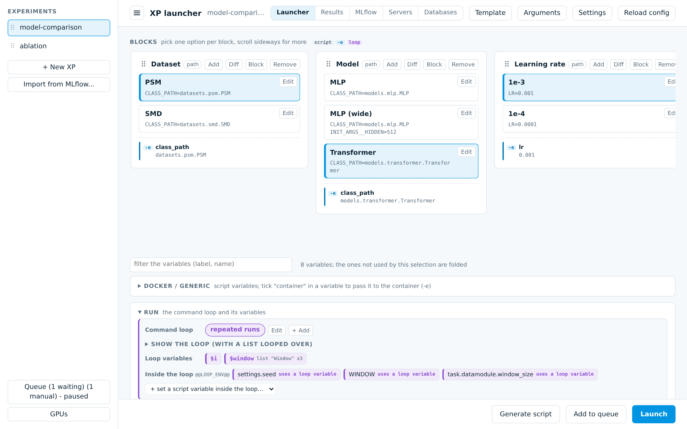
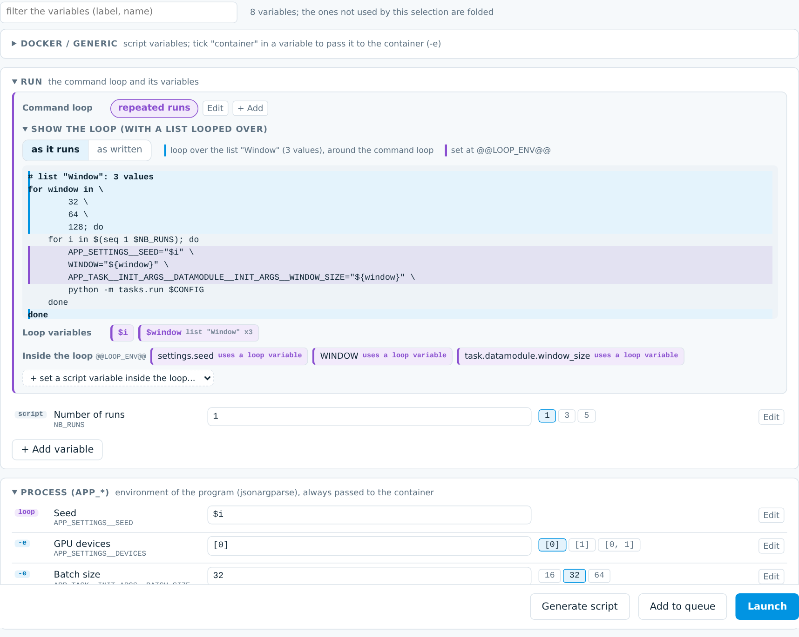
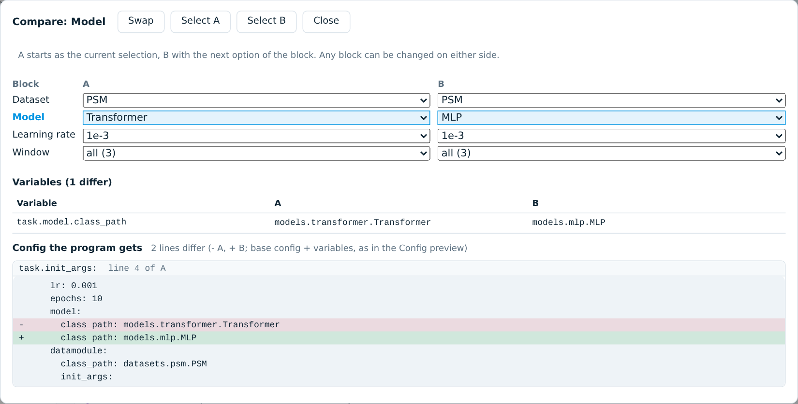
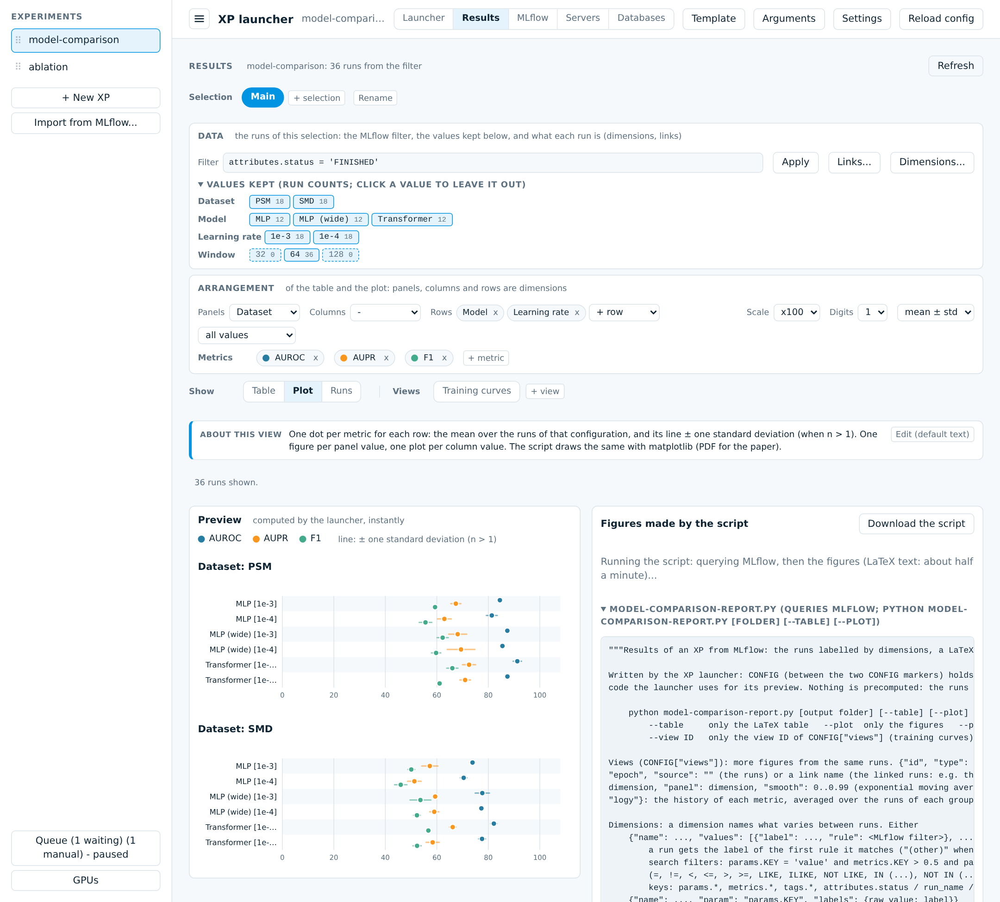
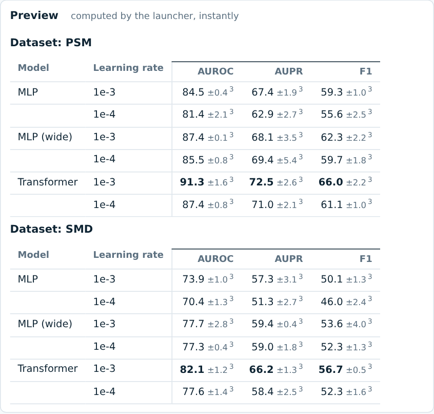
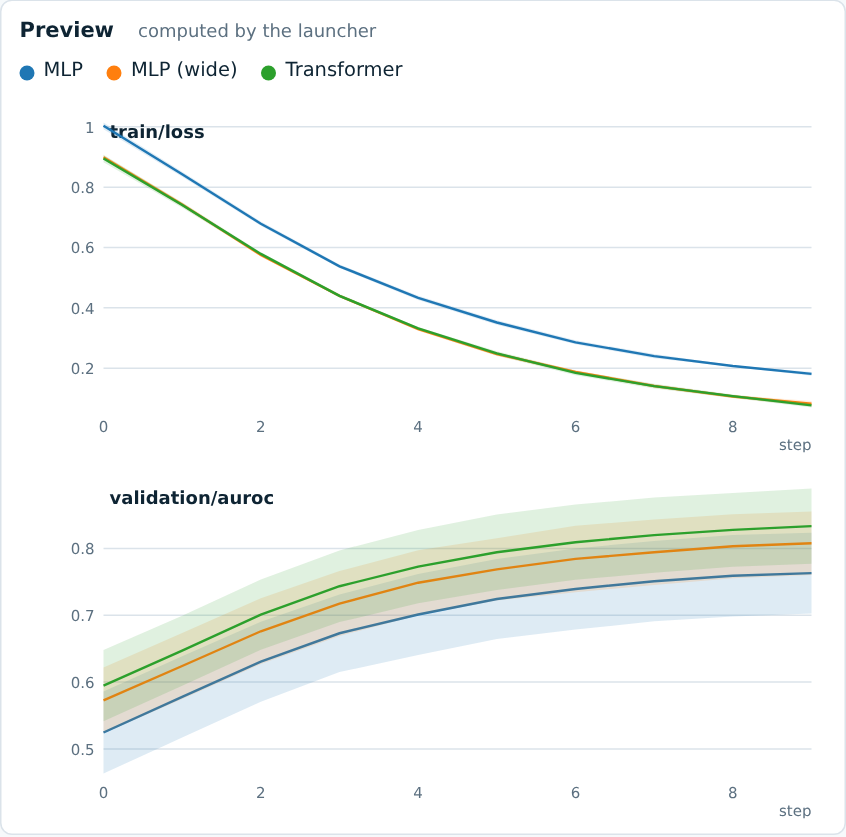
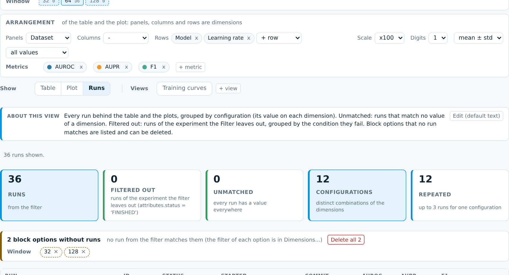
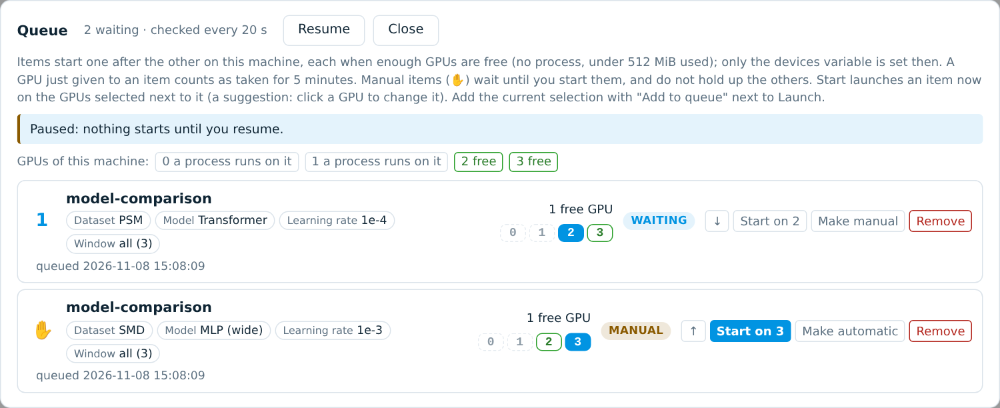
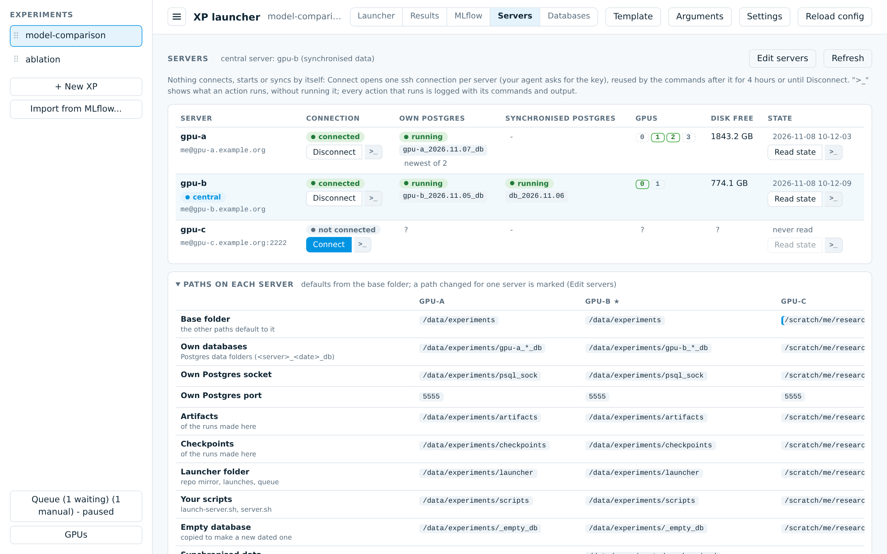
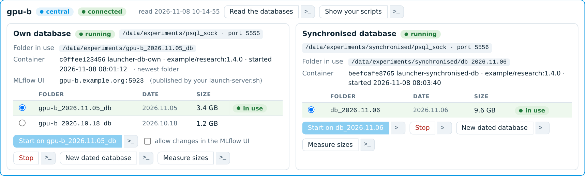

# experiments-handler

A small web app to build, launch and analyse the experiments of a Python research project configured with
[jsonargparse](https://jsonargparse.readthedocs.io) and tracked with [MLflow](https://mlflow.org).

- **Launcher**: an *XP* is a list of *blocks*; each block has *options* that set environment variables
  (`APP_TASK__INIT_ARGS__LR=0.001`). Picking one option per block gives a shell script, generated from a template
  (typically: a docker container that checks out a commit and runs a command loop). The page shows the config the
  program will get, checks every variable against the classes of the source folder (ignored, overwritten, missing
  arguments), compares two selections (Diff), and can write base configs from scratch with an argument browser.
  A *list* block holds values (run ids, window sizes...): pick one or several, or loop over all of them around the
  command loop. Every view has its own address (bookmark it, open it in another tab).
- **Results**: the MLflow runs of an XP, labelled by *dimensions* (from the blocks, or MLflow filters), shown as a table,
  dot plots and a list of runs, with a report script (LaTeX table, PDF figures) that queries MLflow itself. Several
  *selections* per XP (filter, values kept, rows and columns), each with its own *views* (training curves...) and a text
  explaining each view. Runs that use another run (e.g. a checkpoint) are linked to it, and what differs between those
  runs becomes dimensions. The Runs view shows the runs the filter leaves out (and why), and the block options that no
  run matches.
- **Queue**: "Add to queue" writes the script of the current selection at once; the queue starts the items one after
  the other on this machine, each when enough GPUs are free (or when you start them, on the GPUs you pick), and only
  sets the devices variable (`…DEVICES`) then. It runs in the app (kept in `.queue.json` next to the settings).
- **Servers** and **Databases**: your GPU servers (add, order, paths of each), one ssh connection per server opened
  when you click Connect, their state (Postgres, GPUs, disk), and the Postgres database of each server (start on a
  dated folder, stop, new dated database). Every action shows its commands before running them, and is logged with
  its output. Nothing connects or starts by itself.
- **MLflow** UI in a tab, and the **GPU** usage of your servers (ssh).

## Screenshots

The screenshots show a made-up demo project (`model-comparison`: two datasets, three models, two learning rates).

**Launcher**: blocks of options, a list looped over, the command loop as it runs, the variables (only the ones used by
the selection are shown).





**Diff** of two selections: the variables and the config the program gets.



**Results**: the data of a selection, how it is arranged, and the dot plot (left: computed in the page; right: the
report script that makes the PDF figures).



| Table | Training curves |
|---|---|
|  |  |

**Runs**: every run behind the table, grouped by configuration, with the block options that no run matches.



**Queue**: items waiting for free GPUs, or started by hand on the GPUs you pick.



**Servers** and **Databases** (the central server keeps the synchronised database).





## Run

```bash
pip install -r requirements.txt
python app.py --config path/to/your/project/tools/experiments/experiments.yaml   # http://127.0.0.1:8000
```

- `--config` (or `XP_CONFIG`): the settings of your project. Created from `defaults.yaml` when missing. Keep it in your
  project (and in its git): the page edits it, the previous version is kept as `experiments.yaml.bak`.
- `--template` (or `XP_TEMPLATE`): the script template; default `template.sh` next to the settings, else
  `template.example.sh`. Edit it in the page (Template) or by hand.
- `project.root` in the settings: the project the scripts run in, absolute or relative to the settings file.
- Files the app writes for itself (`.gpu-servers.json`, `.mlflow-server.log`, `.queue.json`, backups, and the action
  log: `actions.log` and `actions/<time>_<action>_<server>/commands.log`) go next to the settings.
  An optional `userlist.csv` there (passwd format) names the owners of GPU processes on servers whose users this
  machine does not know.
- Generated scripts go to `<project>/<scripts_dir>/<XP>/`, base configs written by the app to
  `<project>/<scripts_dir>/<XP>/configs/` (copied into the container by `@@COPY_FILES@@`).

**Security**: the app writes and runs shell scripts, and runs the report scripts it generates. It listens on
127.0.0.1 by default; use `--host 0.0.0.0` only on a network you trust.

Optional: `latex` and `dvisvgm` to show the LaTeX tables compiled; a LaTeX install with `LM Roman` for the PDF figures.

## Conventions it assumes

- Configs are jsonargparse YAML (`class_path` / `init_args`); environment variables `<env_prefix><PATH>` with
  `<env_sep>` override any field (`APP_TASK__INIT_ARGS__BATCH_SIZE`), as in a parser that reads them.
- A `subconfig:` key merges another YAML file (path relative to the file); a variable ending in `SUBCONFIG` replaces it.
- The root config has `task` (a task class, whose `links()` may fill arguments) and `settings`.
- Default metrics of the Results tab are looked for as `test/<metric>` (AUROC, AUPR, F1, ...); add any metric in the page.

## Files

| | |
|---|---|
| `app.py` | Flask app and JSON API |
| `core.py` | settings (load, normalise, save), variables of a selection, script rendering |
| `preview.py`, `checker.py`, `picker.py`, `indexer.py` | config preview, variable checks, argument browser (static scan of the source folder) |
| `xpconfigs.py` | base configs written by the app, XPs imported from MLflow runs |
| `results.py`, `report_template.py` | Results tab; `report_template.py` is also the code of the generated report scripts |
| `diffview.py`, `gpus.py`, `mlflow_ui.py` | Diff of two selections, GPU view, MLflow UI proxy |
| `remote.py`, `actions.py` | servers and their databases over ssh; every action as a list of commands, shown first and logged |
| `db/launch.sh`, `db/serve.sh` | a Postgres database and its MLflow UI in a container: copied to `<launcher>/db` on the server and run by Databases > Start (image chosen at each start) |
| `xpqueue.py` | queue of experiments (frozen scripts, started when their GPUs are free) |
| `*.js`, `app.css`, `index.html` | the page (no build step) |
| `defaults.yaml`, `template.example.sh` | example settings and script template |
